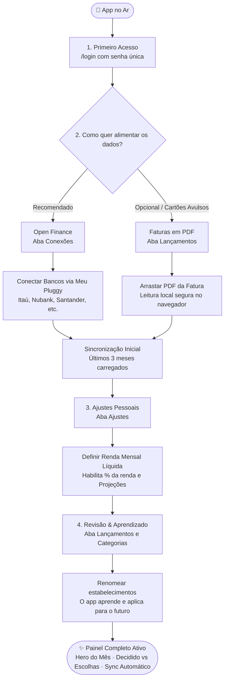

# 🧭 Raio-X — Fluxo de Configuração Pós-Deploy

Este guia apresenta o passo a passo simplificado e o organograma visual de como configurar e começar a usar o **Raio-X** logo após o app estar rodando (seja na Vercel ou localmente).

---

## 📊 Organograma do Fluxo

---

## 🛠️ Passo a Passo Simplificado (5 Etapas)

### 1. Primeiro Acesso
- Acesse direto a rota privada: `https://seusite.com/login`
- Digite a sua senha mestra (a mesma que você usou para gerar o `APP_PASSWORD_HASH`).
- Ao entrar, você verá a tela inicial convidando a carregar o primeiro mês.

---

### 2. Conectar Bancos via Open Finance (Recomendado)
- No menu, clique em **Conexões** (`/conexoes`).
- Clique no botão **Conectar conta** para abrir o modal oficial do Pluggy.
- Escolha sua instituição (Nubank, Itaú, Santander, Sicredi, Inter, etc.) e autorize a leitura.
- O app puxará automaticamente os saldos, faturas e lançamentos dos últimos 90 dias.

> **Segurança:** A conexão do Open Finance é somente leitura. O app nunca tem permissão para movimentar dinheiro ou fazer transações.

---

### 3. Importar Faturas em PDF (Se necessário)
- Se você tem cartões adicionais, bancos não suportados ou faturas antigas que quer analisar:
- Acesse **Lançamentos** (`/lancamentos`) e clique em **Importar fatura em PDF**.
- Arraste o arquivo `.pdf`.
- O processamento é **100% privado**: os dados sensíveis (CPF, nome, endereço) são apagados antes de qualquer leitura.

---

### 4. Definir Renda Mensal (Para ativar métricas inteligentes)
- Acesse **Ajustes** (`/ajustes`).
- No campo **Renda mensal líquida**, digite quanto você recebe líquido por mês (ex.: `8500`).
- Isso ativa no Painel:
  - O indicador de **% da renda comprometida**;
  - O cálculo de quanto sobra de **Margem de Escolha** após pagar fixos e parcelas.

---

### 5. Ensinar o App (Ajuste Fino Inicial)
- Ao navegar pelos lançamentos, se algum nome estiver estranho (ex.: `PAG*Loj...`):
- Clique no nome do estabelecimento e dê um apelido amigável (ex.: `Padaria São Bento`).
- Se quiser, corrija a categoria.
- **O Raio-X aprende na hora**: todas as compras futuras desse estabelecimento já virão com o nome limpo e a categoria certa.

---

## 🔄 Como Funciona a Rotina Automática depois de configurado?

Você **não precisa lançar gastos manualmente**:
- **Diariamente às 09:00**: O cron configurado no `vercel.json` roda em segundo plano e sincroniza novas compras;
- **Webhooks do Pluggy**: Notificam compras em tempo real quando o banco atualiza;
- **Você só abre o app para consultar**: ver o total do mês, a projeção de fechamento da fatura e sua margem livre.
