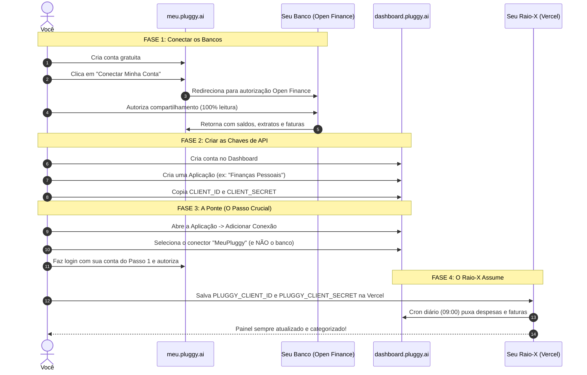

# 🇧🇷 Como Funciona o Fluxo do Meu Pluggy com o Raio-X

O **Meu Pluggy** é a iniciativa oficial da [Pluggy](https://www.pluggy.ai/meu-pluggy) que oferece **acesso gratuito à API do Open Finance brasileiro** para uso pessoal.

Com ele, você conecta até 5 bancos (Nubank, Itaú, Santander, Inter, BB, etc.) sem pagar mensalidade e sem prazo de expiração.

---

## 🧭 O "Pulo do Gato": Por que existem 2 sites?

Muitos desenvolvedores se perdem porque a Pluggy separa o processo em dois ambientes:

| Ambiente | URL | Para que serve? |
| :--- | :--- | :--- |
| **1. Meu Pluggy** | `meu.pluggy.ai` | **Onde os bancos se conectam.** É onde você autentica suas contas bancárias via Open Finance (com QR Code ou app do banco). |
| **2. Dashboard** | `dashboard.pluggy.ai` | **Onde a API é criada.** É onde você pega o `CLIENT_ID` e o `CLIENT_SECRET` para colocar no Raio-X. |

Para os dados saírem do *Meu Pluggy* e chegarem à API do *Dashboard*, você ativa o conector **"MeuPluggy"** no Dashboard. Essa é a ponte mágica.

---

## 📊 Organograma do Fluxo Passo a Passo

---

## 🛠️ Passo a Passo Detalhado (Em 6 Etapas)

### 1. Crie sua conta no Meu Pluggy
- Acesse [meu.pluggy.ai](https://meu.pluggy.ai) e cadastre seu e-mail e senha.
- Não precisa de aprovação nem fila de espera.

---

### 2. Conecte suas contas bancárias
- No Meu Pluggy, clique em **"Conectar Minha Conta"** e escolha o seu banco (ex.: Nubank, Itaú, Inter).
- O site levará você para o app ou site do seu banco para confirmar o consentimento pelo **Open Finance**.
- **Importante:** Vá até o fim no banco e espere ser redirecionado de volta para o Meu Pluggy.
- Repita para cada banco que você possui (até 5 contas no plano gratuito).

---

### 3. Crie sua conta no Dashboard
- Acesse [dashboard.pluggy.ai](https://dashboard.pluggy.ai) (de preferência com o mesmo e-mail).
- *Nota:* Se aparecer um aviso de "teste de 15 dias", ignore: o uso pessoal via Meu Pluggy é **gratuito e sem prazo de expiração**.

---

### 4. Crie uma Aplicação
- No menu do Dashboard, crie uma **Aplicação** (ex.: `Raio-X Pessoal`).
- Apenas uma aplicação é suficiente para reunir todos os seus bancos.

---

### 5. Copie o Client ID e o Client Secret
- Abra a aba **"Aplicação"** no Dashboard.
- Copie as duas chaves:
  - `PLUGGY_CLIENT_ID`
  - `PLUGGY_CLIENT_SECRET`
- Cole essas duas variáveis no seu `.env.local` e nas **Environment Variables da Vercel**.

---

### 6. Ative o conector "MeuPluggy" (O passo que muitos pulam!)
- Dentro da sua Aplicação no Dashboard, clique em **"Conectar Conta"**.
- Vai abrir um seletor de conectores:
  - ❌ **NÃO escolha o seu banco aqui** (você já conectou os bancos no Meu Pluggy no passo 2);
  - ❌ **NÃO escolha Sandbox** (que contém dados falsos);
  - ✅ **Escolha o conector chamado "MeuPluggy"**.
- Faça login com a sua conta do *meu.pluggy.ai* (do passo 1) e clique em Autorizar.

> **Como saber se deu certo:**
> Na sua aplicação do Dashboard, a conexão do conector *MeuPluggy* deve aparecer como **Ativa / Conectada**. A partir desse instante, a API da Pluggy tem permissão para repassar os dados dos seus bancos para o seu Raio-X!

---

## ⚡ Como o Raio-X usa essas credenciais?

Depois que você configura `PLUGGY_CLIENT_ID` e `PLUGGY_CLIENT_SECRET`:
1. **Sincronização Diária**: O cron do Raio-X roda todos os dias às 09:00 e busca faturas fechadas, faturas abertas e lançamentos dos últimos 90 dias;
2. **Webhooks em Tempo Real**: Quando um cartão fecha ou há novos lançamentos, o Pluggy avisa seu app instantaneamente;
3. **Privacidade e Posse**: O Raio-X armazena os dados no seu próprio PostgreSQL (Neon). Você nunca mais perde o histórico, mesmo que troque de banco.
